# SEM Batch Identification — London AI × Science Hackathon (Track 4)

Identify which manufacturing batch an SEM image of a graphite + SiOx battery anode came from, explain the call with
visible material evidence, and state how certain it is.

Three reference batches of SEM images are known; each location of an unknown batch must be assigned to batch 1, 2 or
3, with an explanation and a stated uncertainty (Track 4, *Materials manufacturing*, set by Polaron).

## What it does

- **Segments** every location into pore, graphite, SiOx and binder with a label-free U-Net, and gives every phase
  fraction a 95 % sampling interval (GET4).
- **Classifies** a location: 90 % a KPI model on the raw BSE / ETD / InLens images, 10 % a material model (U-Net
  features + DINOv2); confidence is High only when both agree. Training images are refused and re-shot known spots
  recognised.
- **Explains** each call with a research-grounded report written by a small team of Claude agents with Corrective RAG.

How the parts fit together: [docs/architecture.md](docs/architecture.md).

### How a location's batch is decided

1. **KPI model (90 % of the probability).** The raw BSE image is split into three brightness classes and compared
   pixel by pixel with the ETD and InLens views, giving 32 KPIs. A diagonal LDA, fitted on the 31 reference locations,
   uses the most batch-separating KPIs that were measured for this location (usually *ETD-dark solid*: area dark in
   ETD but solid in BSE, which needs an ETD image).
2. **Material model (10 %, and the check).** Five measurements from the U-Net segmentation plus DINOv2 texture
   features, calibrated on the references.
3. **Answer and confidence.** The batch with the highest combined probability. Confidence is **High** when the KPI
   model is at least 50 % sure *and* the material model picks the same batch, otherwise **Low**.
4. **Overrides.** An image identical to a training image is refused; a re-shot of a known reference location gets that
   location's batch.

## Requirements

- Python 3.14 (tested) and Node.js 22 (as in CI).
- For the Demo: PyTorch and the SEM-pipeline packages. A CUDA GPU is fastest; a recent laptop CPU (tested on an
  Apple M2 Pro) takes about 45 s per location.
- The reference TIFFs (about 1.6 GB) and the trained models from the GitHub release; neither is in Git.
- For **Generate report** only: an Anthropic API key.

## Quick start

1. Put the reference TIFFs in `ReferenceBatches/Batch_1..3/` and unpack the trained models from release
   [`models_v3.0.zip`](https://github.com/Project-81-83-50/London-AI-x-Science-Hackathon/releases/tag/tagtag) (which
   file goes where: [docs/getting-started.md](docs/getting-started.md#files-you-must-add-locally)).
2. Start the website: `scripts\start_website.bat` on Windows, `./scripts/start_website.sh` on macOS / Linux. It sets up
   `.venv` and the frontend on first run, then opens <http://localhost:5173>.
3. Once, generate the reference reports: `.venv/bin/python -m analysis.reports` (Windows:
   `.venv\Scripts\python.exe -m analysis.reports`).

The Demo needs PyTorch and the pipeline packages, and **Generate report** needs an Anthropic API key; both are covered
in [docs/getting-started.md](docs/getting-started.md), including a macOS (CPU) setup.

## Data that is not in Git: `ReferenceBatches/` and `data/`

Both folders are listed in `.gitignore`, so `git add .` skips them and they are never pushed to GitHub. Every
teammate creates them locally.

| Folder | What it holds | Why it is not in Git |
| --- | --- | --- |
| `ReferenceBatches/Batch_1..3/` | the original SEM TIFFs of the three reference batches (93 images, about 1.6 GB) | far beyond GitHub's file and repository limits (100 MB per file), and the dataset is shared only with its owner's permission, so it must not be published |
| `data/raw/unknown/` | optional TIFFs of the unknown batch | same reasons as above |
| `data/processed/` | everything generated from the images: KPI data, GET4 reports, General / Detailed reports, previews, research caches | generated output: it can always be rebuilt from the images, and would go stale in Git |

The trained models (`sem_pipeline/models/`) are excluded for the same reason and come from the GitHub release instead
(see Quick start).

### Recreating `ReferenceBatches/`

1. Get access to the original
   [Google Drive dataset](https://drive.google.com/drive/folders/12UnB4HYDElXzoR4I0mG7NZ0buSr4QXF6) from its owner (or
   ask a teammate who has the files).
2. Download the three batch folders and put the TIFFs directly in `ReferenceBatches/Batch_1/`, `Batch_2/` and
   `Batch_3/` at the repository root, keeping the original names (`img_<location>_<detector>.tif`; no extra nested
   folders). `ReferenceBatches/` should hold 21, 21 and 51 TIFFs.
   - Alternatively, once you have access, `python scripts/fetch_missing.py` (run from `batch_match/`) downloads the
     files listed in `batch_match/scripts/drive_files.json` into `batch_match/data/batches/`; move them into
     `ReferenceBatches/Batch_N/` afterwards.
3. On the website's first page, click **Refresh local images**: each batch should show its images.

### Recreating `data/`

With `ReferenceBatches/` in place, run once from the repository root (about 3 minutes):

```bash
.venv/bin/python -m analysis.reports      # Windows: .venv\Scripts\python.exe -m analysis.reports
```

This creates `data/processed/` (KPI data for the Demo's KPI model, GET4 reports, General and Detailed reports).
Image previews and research caches are added by the website as it is used. Rerun the command whenever the reference
images change. `data/raw/unknown/` is only needed if you have unknown-batch images: copy those TIFFs there.

## A tour of the website

The website has three pages, linked from the top bar: **Batches** (explore the reference data), **Demo** (classify a
new location) and **Pipeline** (inspect every step of a classification). The screenshots below follow a typical visit.

### 1. Batches: your reference library

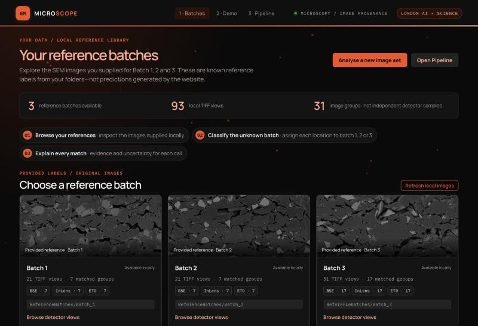

The landing page. The counters at the top read the TIFFs in `ReferenceBatches/` directly (here 3 batches, 93 images
from 31 locations). Each card shows a batch's image count and detectors; click **Browse detector views** to open it.
**Analyse a new image set** jumps to the Demo, and **Refresh local images** rescans the folders after you add files.

### 2. Images tab: every detector view of every location

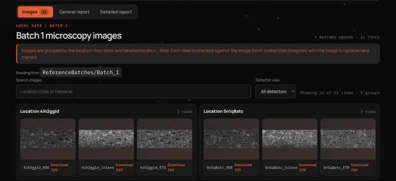

The images of the selected batch, grouped by the location they show, with one tile per detector (BSE, InLens, ETD).
Search by location code or filename, filter by detector, click a tile to enlarge it, or download the original TIFF.
Labels are checked against the pixels, so a mislabelled file is corrected and marked.

### 3. General report: the batch at a glance

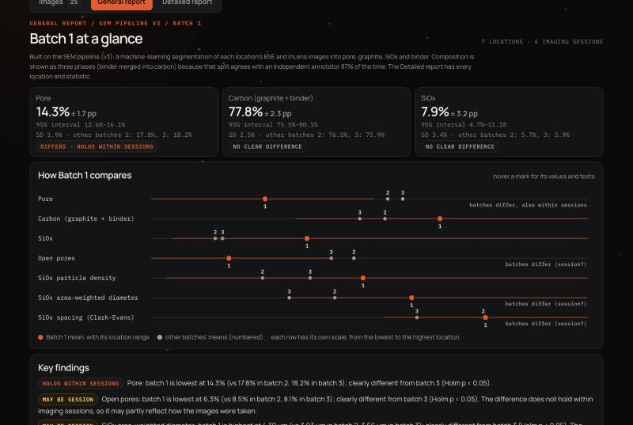

The batch's composition from the U-Net segmentation, as pore / carbon / SiOx with a 95 % interval (for example
14.3 % ± 1.7 pp pore), next to the other batches' means. **How Batch N compares** places this batch (orange) against
the others (numbered) on seven measurements; hover a mark for its values and statistical tests. **Key findings** lists
the differences that are statistically clear, marked *holds within sessions* or *may be session*.

### 4. How sure are these numbers? (GET4 uncertainty)

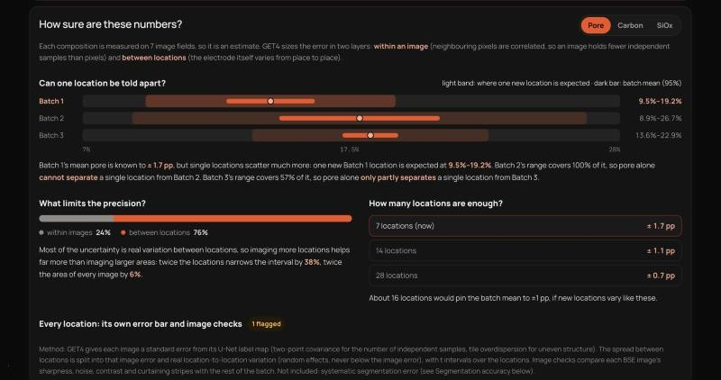

Further down the General report, pick a phase (Pore / Carbon / SiOx). **Can one location be told apart?** draws, for
each batch, the batch mean's 95 % interval (dark bar) and where a single new location is expected (light band); the
sentence below says how much the ranges overlap, which is why one location from Batch 1 or Batch 2 is hard to place.
**What limits the precision?** splits the uncertainty into within-image and between-location parts, and **How many
locations are enough?** shows how the interval shrinks with more locations. **Every location** expands to each
location's own error bar and GET4's image-quality checks.

### 5. Detailed report: every location and test

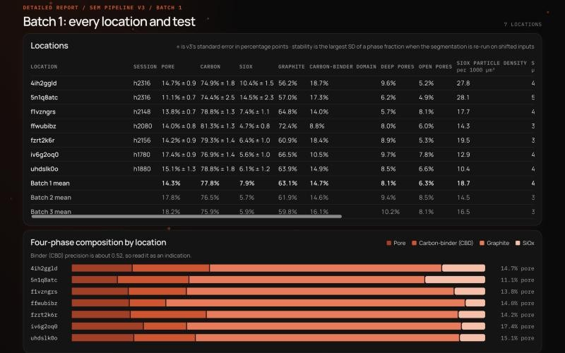

One row per location: three-phase composition with its standard error, the four phases, deep and open pores, SiOx
particle density, size and spacing, the segmentation's stability and the held-out decision for that location. Below
the table follow a four-phase composition chart and every batch comparison with its p-values.

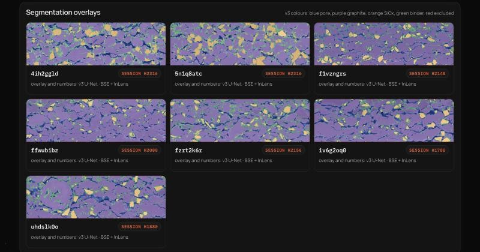

The U-Net segmentation of each location drawn over its BSE image: blue pore, purple graphite, orange SiOx, green
binder. Click an overlay to open it at full size.

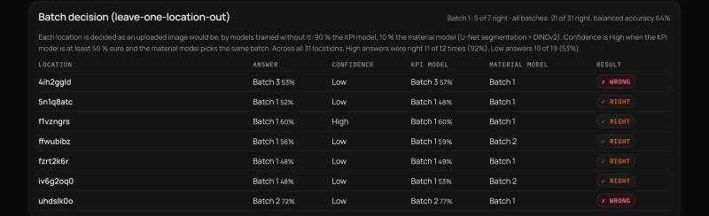

**Batch decision (leave-one-location-out)** shows how the website's own decision rule does on this batch: each
location is decided as if it were an upload, by models trained without it, with the KPI model's and the material
model's picks and whether the answer was right. The heading gives the totals over all 31 locations.

### 6. Demo: classify a new location

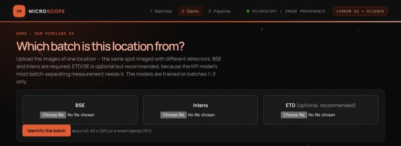

Choose the BSE and InLens TIFFs of one location (ETD is optional but recommended) and click **Identify the batch**.
The steps light up as the run progresses (about 1 minute); the answer appears with its confidence and probabilities,
and **See every step in the pipeline** opens the run on the Pipeline page. A reference image is refused on purpose, as
it would not be a test.

### 7. Pipeline: from images to a batch call

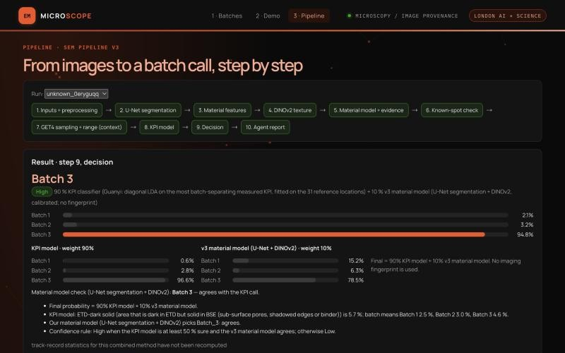

Pick a run (your Demo uploads and the nine unknown-batch locations). The diagram lists the ten steps; click one to jump
to it. **Result** gives the answer and confidence, the final probabilities, and the two models behind them: the KPI
model (90 %) and the material model (10 %), with the reasons in plain words.

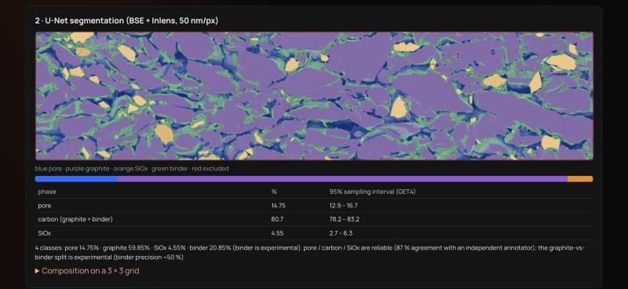

Step 2 shows the segmentation of the uploaded location with its composition and GET4 95 % sampling intervals; step 3
lists the five material features measured from it.

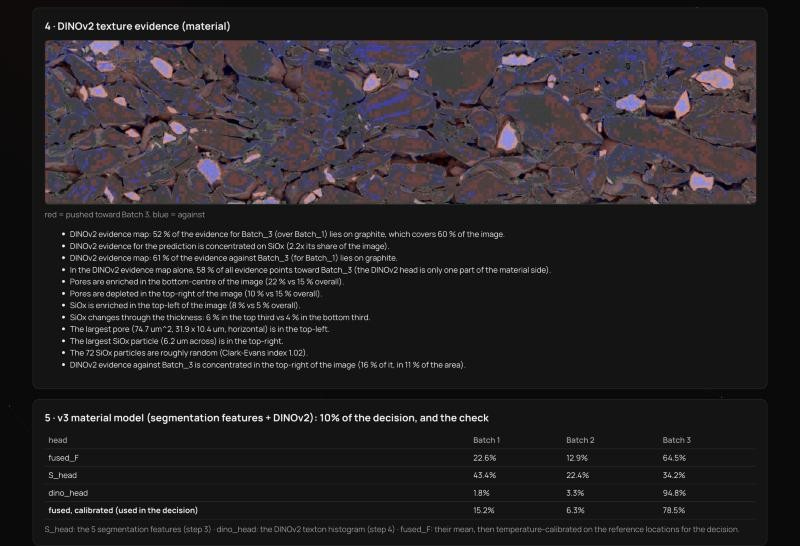

Step 4 is the DINOv2 evidence map: red regions push towards the predicted batch, blue against, summarised in sentences
underneath. Step 5 shows the material model's probabilities, including the calibrated values used in the decision.

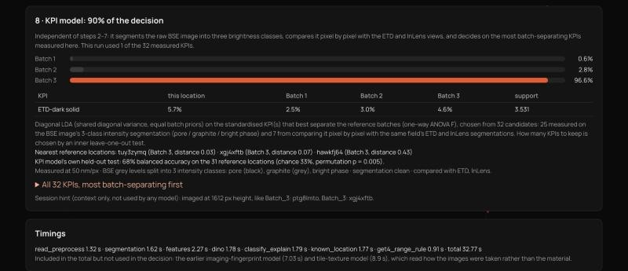

Step 8 is the KPI model, which carries 90 % of the decision: the deciding KPI with this location's value against the
three batch means, the nearest reference locations, and the model's own held-out accuracy. **All 32 KPIs** expands the
full list.

### 8. Agent report: the explanation

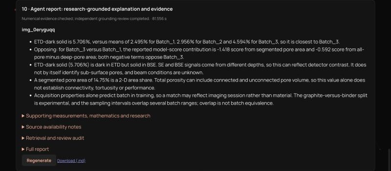

At the bottom of the Pipeline page, **Generate report** asks a small team of Claude agents to explain the call (about
1.5 minutes). The report gives short points: the deciding evidence (here ETD-dark solid 5.7 % against the batch means),
the opposing evidence, scientific interpretations backed by retrieved research, and the limitations. The status line
confirms that every number was checked and an independent reviewer approved the claims. It needs an Anthropic API key
([docs/research-reports.md](docs/research-reports.md)).

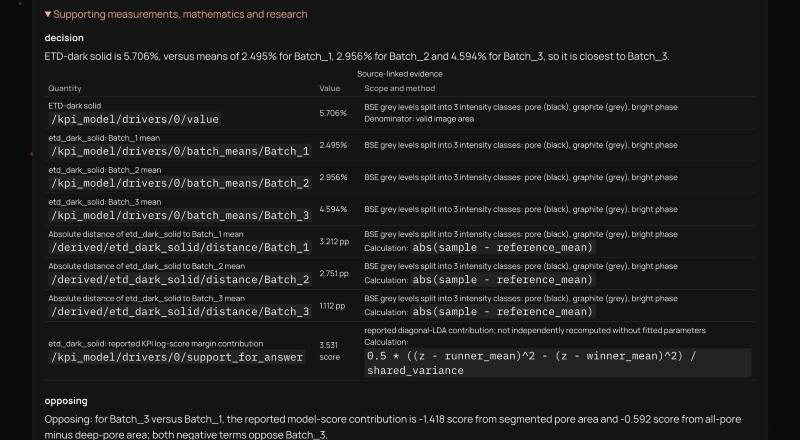

**Supporting measurements, mathematics and research** opens the evidence behind every point: each number with the
field of the run it comes from, the calculation that produced it, and, for interpretations, the cited source (for
example *Effect of Calendering on Electrode Wettability in Lithium-Ion Batteries*, 2014). Further panels list the
retrieval and review audit, and **Download (.md)** saves the report.

## Results

All accuracies are leave-one-location-out on the 31 reference locations (7 / 7 / 17): each location is predicted by
models that never saw it. Balanced accuracy is used because Batch 3 dominates; chance is 33 %.

| What | Result |
| --- | --- |
| Segmentation vs. a blind independent annotator | 87 % (pore / carbon / SiOx), 82 % with binder separate; binder precision only ~0.5 |
| KPI model (90 % of the decision) | 68 % balanced accuracy, nested test, permutation p = 0.005; recall 71 / 57 / 76 % for batches 1 / 2 / 3 |
| Material model (10 %) | 61 % balanced accuracy, permutation p = 0.005 |
| Final decision (90 % KPI + 10 % material) | 21 of 31 right, 64 % balanced accuracy; **High-confidence answers right 11 of 12 (92 %)**, Low 10 of 19 |

Calls for the nine unknown locations:

| Answer | Locations | Confidence |
| --- | --- | --- |
| Batch 3 | `0eryguqq`, `fhwrjtet`, `xrv9xvzb` | High |
| Batch 1 | `4hq27w4c`, `fn0mhxef` | High |
| Batch 1 | `y59rxmxl` | Low (material model says Batch 2) |
| Batch 2 | `3e122cbj` | Low (material model disagrees) |
| Batch 2 | `fspqbkxl`, `soo2ax3r` | Low (KPI model below 50 %) |

Details: [sem_pipeline/reports/report.md](sem_pipeline/reports/report.md) and [docs/analysis.md](docs/analysis.md).

## Troubleshooting

| Symptom | Cause and fix |
| --- | --- |
| "API unreachable" at the bottom of the Batches page | The API is not running: start it with the launcher (or see [running the parts by hand](docs/getting-started.md#running-the-components-manually)) and check that `frontend/.env` points to its port. |
| A batch card says *Folder not found* or shows 0 images | `ReferenceBatches/Batch_N/` is missing or has a nested folder; see [Recreating `ReferenceBatches/`](#recreating-referencebatches), then click **Refresh local images**. |
| General or Detailed report: "No v3 report …" | Reports were never generated: run `python -m analysis.reports`. |
| Demo fails at "U-Net segmentation" or straight away | The model files or PyTorch are missing: unpack `models_v3.0.zip` and install the pipeline packages ([getting started](docs/getting-started.md)). |
| Demo answer is refused | The upload is pixel-identical to a reference image; this is by design. |
| **Generate report** fails with a credentials error | Set `ANTHROPIC_API_KEY` in `sem_pipeline/.env` (copy `.env.example`), then try again. |

## Documentation

| | |
| --- | --- |
| [Getting started](docs/getting-started.md) | install, data and model files, macOS, running the parts by hand |
| [Architecture](docs/architecture.md) | components, how one location is classified, where outputs live |
| [Analysis reference](docs/analysis.md) | every analysis stage with its command, outputs and API routes |
| [Research reports](docs/research-reports.md) | the agent-written reports: configuration, evidence policy, CLI |
| [Development](docs/development.md) | tests, linting, repository layout and conventions |

## Repository at a glance

```text
frontend/      React + Vite website          backend/       FastAPI service
analysis/      KPIs, classifier, GET4        sem_pipeline/  v3 SEM pipeline (U-Net, DINOv2, models)
batch_match/   earlier classifier            knowledge/     reference data for the report agents
docs/          documentation                 tests/         pytest suite
scripts/       website launchers
```

Never commit `.env` files, raw images or model weights.
